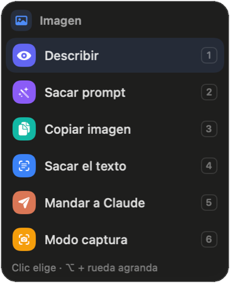
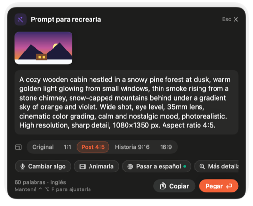

# Dixity

**Dictado por voz para Mac que escribe como vos.** Apretás una tecla, hablás y el texto aparece prolijo donde está
el cursor: sin muletillas, con tus correcciones aplicadas ("a las tres, no, a las cuatro" → "a las 4") y bien
puntuado. Y con la **Varita**, sacudís el mouse, señalás cualquier cosa de la pantalla y elegís qué hacer con eso.

App nativa en Swift que vive en la barra de menú. Funciona **sin internet** con modelos en la Mac, o con **tu propia
IA** (OpenAI, Anthropic, Grok, Groq, OpenRouter o cualquiera compatible con OpenAI). Sin cuenta, sin suscripción y sin
un servidor en el medio. Se actualiza sola.

**[Read it in English](README.md)** · **[Manual](docs/MANUAL.md)** ([in English](docs/MANUAL.en.md)) ·
**[Sitio](https://dixity.halyon.app/es/)**

## Instalarla

1. Bajá el `.zip` de la [última versión](https://github.com/Halyon85/dixity/releases/latest), abrilo y pasá **Dixity**
   a la carpeta Aplicaciones.
2. Abrila. **La primera vez macOS la frena**, porque todavía no está firmada con Developer ID de Apple. Andá a
   **Ajustes del Sistema › Privacidad y seguridad**, bajá hasta el aviso de Dixity y tocá **Abrir igual**. Se hace una
   sola vez.
3. Dale permiso de **Micrófono** y **Accesibilidad** (General › Permisos, en el panel de Dixity). **Grabación de
   pantalla** es opcional: sirve para que lea la pantalla y para que la Varita copie y lea imágenes.
4. Elegí cómo usarla en **Proveedores**: todo en la Mac o con tus propias claves.

**Actualizaciones:** Dixity se actualiza sola. Cuando sale una versión nueva, te avisa y la instala; no hace falta
volver a bajarla.

También se puede compilar desde el código (ver [Compilar](#compilar)).

## Dictado

- **Dictar en cualquier app**: mantené el atajo mientras hablás, o tocalo una vez para empezar y otra para terminar.
- **Reescribir lo seleccionado**: seleccioná texto, usá el atajo de reescribir y decí "más formal", "para un mail",
  "traducilo al inglés". El texto nuevo reemplaza al seleccionado.
- **Modos**: Común, Prompt para IA (Claude, ChatGPT, Codex, Cursor…), Correo, Mensaje, Formal y Traducir. Se eligen
  solos según la app, con ⌃⌥ + número, tocando un número mientras grabás o diciéndolo ("…en formato correo").
- **Entiende el contexto**: lee el texto alrededor del cursor y, si querés, el de la pantalla (se lee en la Mac; la
  imagen no se guarda ni se manda) para escribir bien los nombres.
- **Diccionario y memoria propios**: un archivo chico en tu Mac con los nombres y términos que usás, que tu IA mantiene
  al día.
- **Extras**: historial de dictados con audio, elegir el micrófono, pausar la música al dictar, limpieza de muletillas
  sin IA, acciones rápidas (Ordenar, Resumir, Corregir), instrucciones por app y atajos para volver a procesar el último
  dictado (⌃⌥R) o sumar la palabra seleccionada al diccionario (⌃⌥D).

## Preguntar (⌃⌥P)

Mantené ⌃⌥P y pedí algo: "respondele que el jueves puedo", "¿cómo se dice esto en inglés?". Con texto seleccionado,
trabaja sobre ese texto; sin selección, puede mirar la ventana de adelante ("resumime esta página", "explicame este
error").

- La respuesta llega en una **tarjeta que se adapta** a lo que muestra: texto con formato y código, una traducción con
  el original a mano, texto leído, links de un QR (nunca los abre solo), tu uso de Claude y Codex con barras, o un
  posteo con una pestaña por red.
- **Botones para seguir**: Pasar a inglés/español, Reformular, Más corto, Más formal o casual, Resumir y **Deshacer**.
- **Gratis, en la Mac y sin IA**: traducir con el traductor de Apple, sacar el texto de una ventana o una imagen, y leer
  códigos QR y de barras.
- **Claude y Codex por voz**: "Claude, ¿por qué falla el login?" le pregunta al `claude` o `codex` que tengas instalado
  sobre el proyecto de adelante, primero solo mirando; edita archivos únicamente si tocás "Hacelo con Claude". "¿Cuánto
  me queda de Claude?" responde al instante, sin IA ni internet.
- **Posteos con tus carpetas**: "Armame un post para LinkedIn sobre…" hace que Claude Code lo arme con la carpeta de tu
  marca, solo leyendo. Dixity nunca publica nada.

## La Varita



Sacudí el mouse y **la flecha se vuelve la Varita**: marca lo que tenés debajo y una cajita te ofrece qué hacer.

- **Clic** lo elige. **⇧ + clic** junta varias cosas (quedan copiadas juntas; podés armar un collage o mandarlas a
  Claude). **⌥ + rueda** agranda lo marcado de una foto a su tarjeta, a la sección y a la ventana entera.
  **⌥ + arrastrar** recorta un recuadro de la pantalla. **1…6** eligen una opción; **Esc** suelta.
- **Caja de texto**: la traduce, reformula o corrige ahí mismo (⌘Z deshace). **Texto seleccionado**: leer en voz alta,
  traducir, resumir, preguntar sobre eso, o "Arreglalo con Claude" si parece un error.
- **Imagen**: Describir, **Sacar prompt** (en alta resolución, con los formatos de Instagram 1:1, 4:5, 9:16 y 16:9;
  "Cambiar algo" por voz; **Animarla** arma un prompt de video de 15 segundos en 9:16 o 16:9), leer su QR, sacar el
  texto, copiarla.
- **Video**: **Copiar este cuadro**. **Logo**: **Recrear logo** (y cambiarle el texto). **Banner**: Recrear banner.
  **Sección, ventana o recorte**: **Hacer maqueta**, un resumen de diseño para mandarle a Claude o pasar a un prompt
  de imagen.
- **Sacar colores**, gratis y en la Mac. **Mandar a Claude / Codex** pega lo elegido en su ventana abierta y te escucha
  para que digas qué querés; nunca aprieta Enter por vos.
- Describir y Sacar prompt usan tu propia IA, una que vea imágenes (OpenAI, Claude, Grok u OpenRouter): la imagen viaja
  solo cuando lo pedís.

<br clear="right" />



## Portapapeles

⌃⌥V abre lo que copiaste en las últimas 24 horas, textos e imágenes. ↩ pega, ⌘1–9 pega rápido. Nunca guarda
contraseñas.

## Motores a elección

| | En la Mac (sin claves) | Con tus propias claves |
|---|---|---|
| Voz a texto | Parakeet v3 / Ultra (se bajan una vez, ~460–600 MB) o el motor de Apple (macOS 26) | OpenAI, Grok, Groq (Whisper), cualquiera compatible con OpenAI |
| Pasar en limpio | Apple Intelligence (macOS 26) o limpieza básica sin IA | OpenAI, Anthropic, Grok, Groq, OpenRouter, cualquiera compatible con OpenAI |
| Imágenes (Varita) | Lo que reconoce la Mac; colores, texto y QR | OpenAI, Claude, Grok u OpenRouter, solo cuando lo pedís |

Las claves quedan en el Llavero de macOS. Con las opciones de la Mac nada sale de tu computadora; con una API, el audio
va solo al proveedor de voz que elegiste, y el texto y las imágenes solo a tu IA.

## Requisitos

- macOS 14 o más nuevo, en una Mac con Apple Silicon. El motor de Apple y Apple Intelligence piden macOS 26.
- Permisos: Micrófono, Accesibilidad (para escuchar el atajo y pegar) y, si querés, Grabación de pantalla (para leer
  la pantalla y que la Varita copie imágenes).

## Compilar

No hace falta un proyecto de Xcode, alcanzan las herramientas de línea de comandos:

```bash
./compilar.sh            # arma build/Dixity.app
./compilar.sh instalar   # además la copia a /Applications y la abre
```

`compilar.sh` firma con tu certificado "Apple Development" si lo tenés (así macOS no pide los permisos de nuevo en
cada compilación) o con una firma local si no.

Modos de prueba: `--capturas <carpeta>` dibuja todas las pantallas en PNG, `--probar-dictado archivo.wav` hace un
dictado completo, `--medir archivo.wav` compara proveedores. Con `DIXITY_CARPETA=/tmp/x` la probás como una
instalación nueva. `./probar.sh` corre las pruebas.

## Créditos y licencia

- Reconocimiento de voz: [Parakeet](https://huggingface.co/nvidia/parakeet-tdt-0.6b-v3) (NVIDIA) y
  [Parakeet Ultra](https://huggingface.co/moondream/parakeet-ultra) (moondream), CC BY 4.0, a través de
  [FluidAudio](https://github.com/FluidInference/FluidAudio) (Apache 2.0, copia recortada en `Vendor/FluidAudio`).
  Los modelos se bajan la primera vez, no vienen con la app. Ver [NOTICE](NOTICE).
- Inspirada en apps como Dropline y Wispr Flow. No usa código, textos ni imágenes de ellas.
- Hecha por [Halyon Team](https://halyon.team) en Argentina.
- Licencia: [Apache 2.0](LICENSE). Si redistribuís Dixity o algo basado en ella, conservá el [NOTICE](NOTICE) y su
  crédito ("Basado en Dixity, de Halyon Team"). El nombre y el logo no están licenciados: ver
  [TRADEMARKS.md](TRADEMARKS.md).

---
Desarrollado por **[Halyon Team](https://halyon.team)** · Hecho en Argentina 🇦🇷
