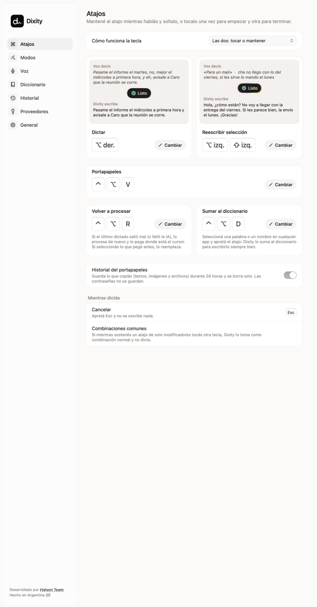
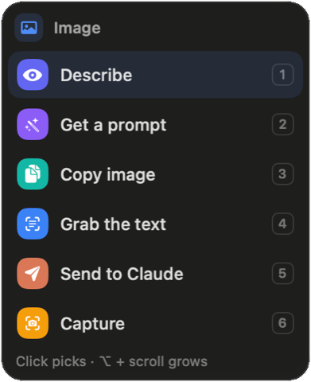
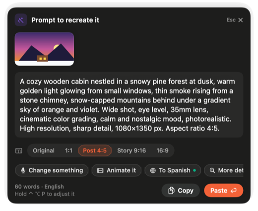

# Dixity

**Voice dictation for Mac that writes like you.** Press a key, talk, and clean text appears wherever your cursor is:
filler words gone, your self-corrections applied ("at three, no, at four" → "at 4"), punctuation in place.
And with **Wonder**, shake the mouse, point at anything on screen and pick what to do with it.

Native Swift menu-bar app. Works **fully offline** with on-device models, or with **your own AI**
(OpenAI, Anthropic, Grok, Groq, OpenRouter or anything OpenAI-compatible). No account, no subscription,
no server in between. Checks for updates every day.

**[Leelo en español](README.es.md)** · **[Manual](docs/MANUAL.en.md)** ([en español](docs/MANUAL.md)) ·
**[Website](https://dixity.halyon.app)**



## Install

1. Download the `.zip` from the [latest release](https://github.com/Halyon85/dixity/releases/latest), open it and move
   **Dixity** to your Applications folder.
2. Open it. **The first time, macOS blocks it**, because it isn't signed with an Apple Developer ID yet. Go to
   **System Settings › Privacy & Security**, scroll down to the message about Dixity and click **Open Anyway**. You only
   do this once.
3. Grant **Microphone** and **Accessibility** (General › Permissions in Dixity's panel). **Screen Recording** is
   optional: it lets Dixity read the screen and lets Wonder copy and read images.
4. Pick how you want to use it in **Providers**: everything on your Mac, or with your own keys.

**Updates:** Dixity checks for a new version once a day. When there is one, it lets you know and installs it only if
you say yes; there's no need to download it again.

You can also build it from source (see [Build](#build)).

## Dictation

- **Dictate anywhere**: hold the shortcut while you talk, or tap once to start and again to finish.
- **Rewrite a selection**: select text, hold the rewrite shortcut and say "more formal", "for an email",
  "translate it to Spanish". The new text replaces the selection.
- **Modes**: Standard, AI prompt (for Claude, ChatGPT, Codex, Cursor…), Email, Message, Formal and Translate.
  Picked per app automatically, with ⌃⌥ + number, by pressing a number while recording, or by saying it
  ("…in email format").
- **Context aware**: reads the text around your cursor and, optionally, the text on screen (read on your Mac; the
  image is never saved or sent) to spell names right.
- **Personal dictionary and memory**: a small local file with the names and terms you use, updated by your AI.
- **Handy extras**: dictation history with audio, pick your microphone, pause music while dictating, basic filler
  clean-up without AI, quick actions (Tidy up, Summarize, Fix spelling), per-app instructions, and shortcuts to process
  your last dictation again (⌃⌥R) or add the selected word to your dictionary (⌃⌥D).

## Ask (⌃⌥P)

Hold ⌃⌥P and ask: "reply that Thursday works for me", "how do you say this in Spanish?". With text selected, it works
on that text; with nothing selected, it can look at the front window ("summarize this page", "explain this error").

- The answer shows up in a **card that adapts** to what it shows: formatted text and code, a translation with the
  original at hand, text it read, links from a QR code (never opened on their own), your Claude and Codex usage with
  bars, or a social post with one tab per network.
- **Buttons to keep going**: To English/Spanish, Rephrase, Shorter, More formal or casual, Summarize, and **Undo**.
- **Free, on your Mac, no AI**: translating with Apple's translator, grabbing the text from a window or an image, and
  reading QR codes and barcodes.
- **Claude and Codex by voice**: "Claude, why is the login failing?" asks the `claude` or `codex` you have installed
  about the project in front, read-only at first; it edits files only if you click "Have Claude do it". "How much
  Claude do I have left?" answers instantly, with no AI or internet.
- **Posts from your folders**: "Write a LinkedIn post about…" has Claude Code draft it from your brand folder,
  read-only. Dixity never posts anything.

## Wonder



Shake the mouse and **the pointer turns into Wonder**: it outlines whatever is under it and a small box offers what to
do with it.

- **Click** picks it. **⇧ + click** collects several things (copied together; make a collage or send them to Claude).
  **⌥ + scroll** grows the outline from a photo to its card, the page section and the whole window. **⌥ + drag** snips
  a box on screen. **1…6** pick an option; **Esc** lets go.
- **Text box**: translate, rephrase or fix it right there (⌘Z undoes it). **Selected text**: read aloud, translate,
  summarize, ask about it, or "Fix it with Claude" when it looks like an error.
- **Image**: Describe, **Get a prompt** (in high resolution, with Instagram formats 1:1, 4:5, 9:16 and 16:9; "Change
  something" by voice; **Animate it** writes a 15-second video prompt in 9:16 or 16:9), read its QR code, grab its
  text, copy it.
- **Video**: **Copy this frame**. **Logo**: **Recreate logo** (and change its text). **Banner**: Recreate banner.
  **Section, window or snip**: **Make a mockup**, a design summary to send to Claude or turn into an image prompt.
- **Get colors**, free and on your Mac. **Send to Claude / Codex** pastes what you picked into its open window and
  listens for what you want; it never presses Enter for you.
- Describe and Get a prompt use your own AI, one that can see images (OpenAI, Claude, Grok or OpenRouter): the image
  is only sent when you ask.

<br clear="right" />



## Clipboard

⌃⌥V opens everything you copied in the last 24 hours, text and images. ↩ pastes, ⌘1–9 pastes fast. Passwords are
never kept.

## Your choice of engines

| | On your Mac (no keys) | Bring your own API |
|---|---|---|
| Speech to text | Parakeet v3 / Ultra (downloaded once, ~460–600 MB) or Apple's built-in engine (macOS 26) | OpenAI, Grok, Groq (Whisper), any OpenAI-compatible |
| Clean-up | Apple Intelligence (macOS 26) or basic clean-up without AI | OpenAI, Anthropic, Grok, Groq, OpenRouter, any OpenAI-compatible |
| Images (Wonder) | What the Mac recognizes; colors, text and QR codes | OpenAI, Claude, Grok or OpenRouter, only when you ask |

Keys are stored in the macOS Keychain. With the local options nothing leaves your Mac; with an API, audio goes only
to the speech provider you chose, and text and images only to your AI provider.

## Requirements

- macOS 14 or later on Apple Silicon. Apple's speech engine and Apple Intelligence need macOS 26.
- Permissions: Microphone, Accessibility (to catch the shortcut and paste) and, optionally, Screen Recording (to read
  the screen and let Wonder copy images).

## Build

No Xcode project needed, just the Command Line Tools:

```bash
./compilar.sh            # builds build/Dixity.app
./compilar.sh instalar   # also copies it to /Applications and opens it
```

`compilar.sh` signs with your "Apple Development" certificate if you have one (so macOS keeps the permissions
between builds) or ad-hoc otherwise.

Handy test modes: `--capturas <folder>` renders every screen to PNG, `--probar-dictado file.wav` runs a full
dictation, `--medir file.wav` compares providers. Set `DIXITY_CARPETA=/tmp/x` to try it as a fresh install.
`./probar.sh` runs the tests.

## Credits and license

- Speech recognition: [Parakeet](https://huggingface.co/nvidia/parakeet-tdt-0.6b-v3) (NVIDIA) and
  [Parakeet Ultra](https://huggingface.co/moondream/parakeet-ultra) (moondream), CC BY 4.0, via
  [FluidAudio](https://github.com/FluidInference/FluidAudio) (Apache 2.0, trimmed copy in `Vendor/FluidAudio`).
  Models are downloaded on first use, not bundled. See [NOTICE](NOTICE).
- Inspired by apps like Dropline and Wispr Flow. No code, text or assets from them are used.
- Made by [Halyon Team](https://halyon.team) in Argentina.
- License: [Apache 2.0](LICENSE). If you redistribute Dixity or build on it, keep the [NOTICE](NOTICE) and its credit
  ("Based on Dixity by Halyon Team"). The name and logo are not licensed: see [TRADEMARKS.md](TRADEMARKS.md).

---
Built by **[Halyon Team](https://halyon.team)** · Made in Argentina 🇦🇷
